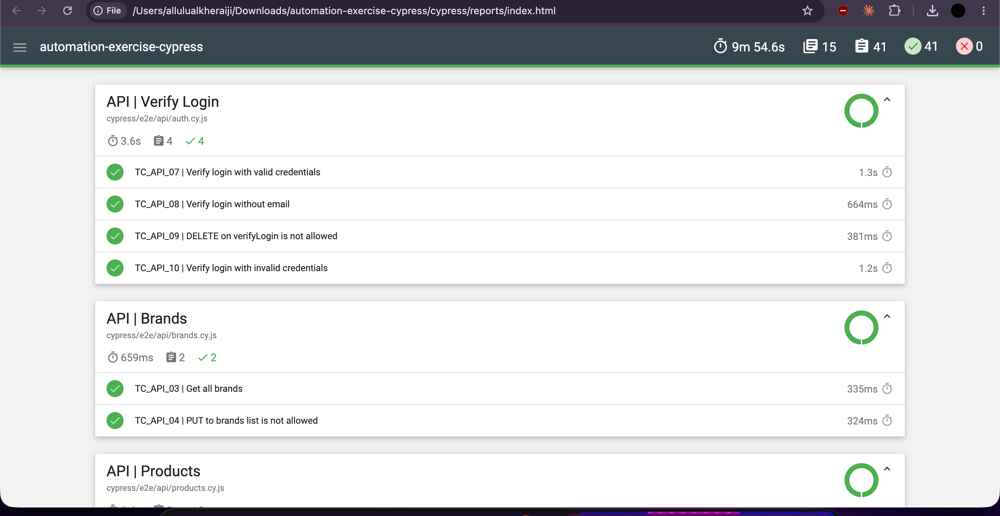

# E2E Test Automation Framework – Automation Exercise (Cypress)


UI and API test automation for [automationexercise.com](https://automationexercise.com), a demo e-commerce site built for automation practice.
Built as my project for the **Software Testing & Automation Bootcamp – Tuwaiq Academy**.

## What it covers

**42 automated test cases** (positive and negative):

| Area | Spec files | Test cases |
|---|---|---|
| UI – Registration | `register.cy.js` | TC_REG_01 – 04 |
| UI – Login / Logout | `login.cy.js` | TC_LOG_01 – 05 |
| UI – Products & Reviews | `products.cy.js` | TC_PRD_01 – 04, TC_REV_01 |
| UI – Search | `search.cy.js` | TC_SRC_01 – 02 |
| UI – Cart | `cart.cy.js` | TC_CRT_01 – 04 |
| UI – Checkout | `checkout.cy.js` | TC_CHK_01 – 04 |
| UI – Contact & Subscription | `contact.cy.js`, `subscription.cy.js` | TC_CNT_01, TC_SUB_01 |
| API | `products`, `brands`, `search`, `auth`, `account` | TC_API_01 – 14 |
| Hybrid (API + UI) | `login-hybrid.cy.js`, `search-hybrid.cy.js` | TC_HYB_01 – 02 |

All test cases are documented with ID, priority, steps and expected results, and every case maps to its Cypress spec file.
**Test cases:** [docs/test-cases.xlsx](docs/test-cases.xlsx)

## Tech stack

- Cypress (JavaScript)
- Page Object Model
- Fixtures and a data factory for unique test data
- Custom commands for API setup and cleanup
- Mochawesome HTML reports
- GitHub Actions (CI on every push)

## Project structure

```
cypress/
  e2e/
    ui/          # UI specs (register, login, cart, ...)
    api/         # API specs
    hybrid/      # API setup + UI verification
  pages/         # Page Objects (locators + actions)
  fixtures/      # Test data
  support/
    commands.js  # Custom commands (API helpers)
    utils/       # Data factory
.github/workflows/cypress.yml
```

## How to run

```bash
npm install
npm run cy:open     # open the Cypress app
npm test            # run all tests headless
npm run test:ui
npm run test:api
```

The HTML report is saved in `cypress/reports/index.html`.

## Design decisions

- **API for setup, UI for verification**: tests create their own users through the API, so they run fast and don't depend on each other.
- **Unique data per run**: every user gets a timestamped email, and accounts are deleted after the test.
- **Third-party ads blocked**: ad requests are stubbed so they don't cause flaky failures.

## Test report

41 / 41 tests passing:


